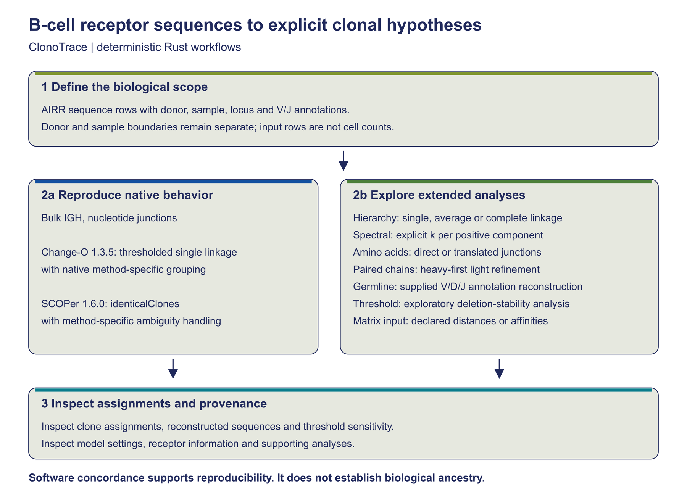
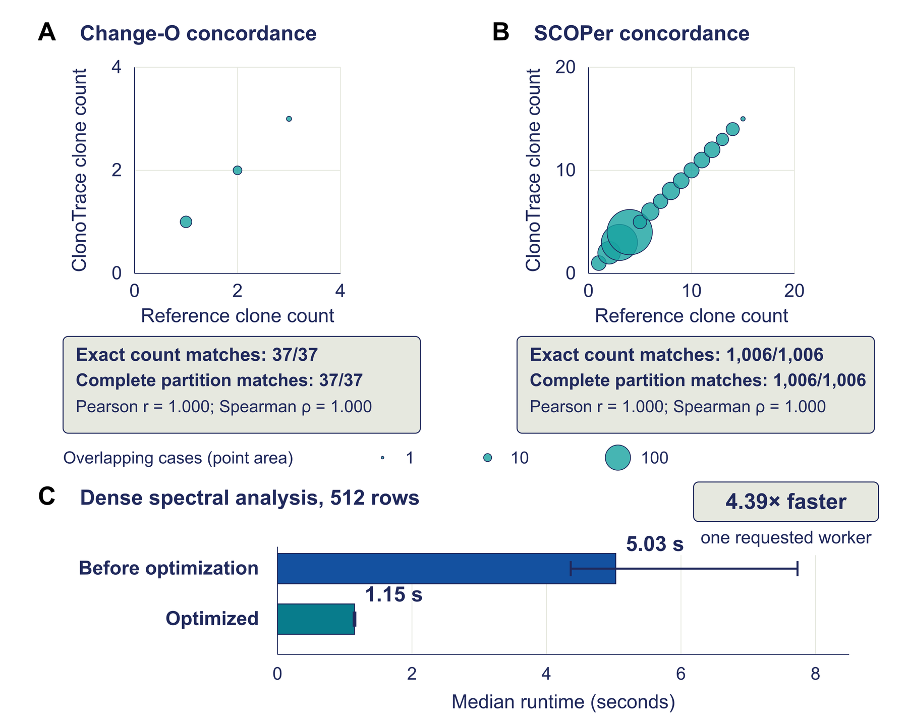

# ClonoTrace

ClonoTrace is a deterministic Rust toolkit for B-cell receptor clonal inference. It reproduces selected Change-O and SCOPer analysis modes and provides explicit alternative models for clustering, paired-chain analysis, amino-acid representation, germline reconstruction, and threshold sensitivity.

ClonoTrace 1.0.0 was qualified on ARM64 macOS. Computational agreement supports software concordance within the tested scope and does not establish biological accuracy.

## Start here

- [Read the user manual](docs/user-manual.md)
- [Read the manuscript](publication/ClonoTrace-Manuscript-v1.0-2026-11-04.pdf)
- [Run the five-minute example](#five-minute-example)
- [Review the qualified scope and limitations](#qualified-scope-and-limitations)

[](docs/assets/ClonoTrace-Figure-1.png)

**Figure 1. ClonoTrace workflow and analytical scope.** ClonoTrace combines selected reference-compatible workflows with explicit alternative receptor models for hierarchical, spectral, paired-chain, amino-acid, germline, and threshold analyses. Select the image to enlarge it.

## What ClonoTrace adds

- Selected Change-O and SCOPer compatible workflows alongside explicit alternative receptor models.
- Deterministic, auditable outputs within the tested scope.
- Hierarchical and spectral clustering, paired-chain refinement, and amino-acid analyses.
- Reference-directed germline reconstruction and threshold-sensitivity analysis.

## Supported workflows

| User goal | Command or method |
| --- | --- |
| Change-O compatible assignment | `clonotrace assign --method changeo` |
| SCOPer compatible assignment | `clonotrace assign --method scoper` |
| Hierarchical clustering | `clonotrace extend --method hierarchical-v2` |
| Spectral clustering | `clonotrace extend --method spectral-v2` |
| Paired-chain refinement | `clonotrace extend --method paired-threshold-v2` |
| Amino-acid grouping | `clonotrace extend --method aa-identity-v2` or `aa-hamming-v2` |
| Reference-directed germline reconstruction | `clonotrace extend --method germline-v2` |
| Threshold-sensitivity analysis | `clonotrace extend --method auto-gap-stability-v2` |

Each workflow needs its own inputs and options; see the [user manual](docs/user-manual.md) for complete commands.

## Installation

Rust 1.98.0 is pinned. If the locked dependencies are not cached, `cargo fetch --locked` may require network access. Once the toolchain and dependencies are available, build offline:

```bash
cargo fetch --locked
cargo build --release --locked --offline
```

See the [user manual](docs/user-manual.md) for detailed installation and platform-specific setup.

## Five-minute example

After dependencies are cached, run from the repository root:

```bash
export CARGO_TARGET_DIR="$PWD/target"
cargo build --release --locked --offline

target/release/clonotrace --version

target/release/clonotrace validate \
  --input examples/repertoire.tsv

mkdir -p out

target/release/clonotrace assign \
  --input examples/repertoire.tsv \
  --out out/changeo \
  --method changeo \
  --threshold .25
```

The output path must be new and its parent must already exist. The included records are synthetic; this example tests software behavior only.

## Validation and local performance

ClonoTrace matched exact clone counts and complete member partitions in all 37 eligible Change-O cases and all 1,006 eligible SCOPer cases. Complete partition agreement is the formal software-concordance result; correlation is descriptive.

On the recorded ARM64 macOS system, the median dense spectral runtime fell from 5.03 to 1.15 seconds, a 4.39-fold improvement with one requested worker. Dense execution showed no meaningful worker scaling. These local measurements are not cross-platform guarantees; benchmark ranges are observed minima and maxima, not confidence intervals.

## Figure 2

[](docs/assets/ClonoTrace-Figure-2.png)

**Figure 2. Computational concordance and dense spectral runtime.** Panels A and B summarize exact clone-count and complete-partition agreement for eligible Change-O and SCOPer cases. Panel C shows the controlled one-worker runtime reduction from 5.03 to 1.15 seconds. Correlation is descriptive; complete partition agreement is the formal concordance result. Select the image to enlarge it.

## Qualified scope and limitations

- Qualification applies only to the documented inputs, parameters, workflows, and environments.
- Clone-count agreement does not establish partition agreement, and partition agreement does not establish biological clone truth. Synthetic examples do not establish lineage truth.
- Germline reconstruction is reference-directed; it is not ancestral inference. Threshold deletion ranges measure sensitivity, not confidence intervals.
- Spectral k is requested, not biologically discovered, and dense spectral work units are limited to 512 rows.
- Multithreading did not cause the 4.39-fold dense runtime improvement.

## Documentation and publication

- [User manual](docs/user-manual.md)
- [Manuscript](publication/ClonoTrace-Manuscript-v1.0-2026-11-04.pdf)

## Citation

Yoon Sing Yap, *ClonoTrace: deterministic clonal inference and alternative receptor models for B-cell repertoires*. See [CITATION.cff](CITATION.cff) and the [manuscript](publication/ClonoTrace-Manuscript-v1.0-2026-11-04.pdf). Repository: [https://github.com/Yoonecorn/ClonoTrace](https://github.com/Yoonecorn/ClonoTrace).

## License

Original ClonoTrace code is licensed **Apache-2.0 OR MIT**. See [LICENSE](LICENSE) and [NOTICE](NOTICE) for license texts and third-party notices.

## Contact

Yoon Sing Yap  
yoonatworkz@gmail.com
